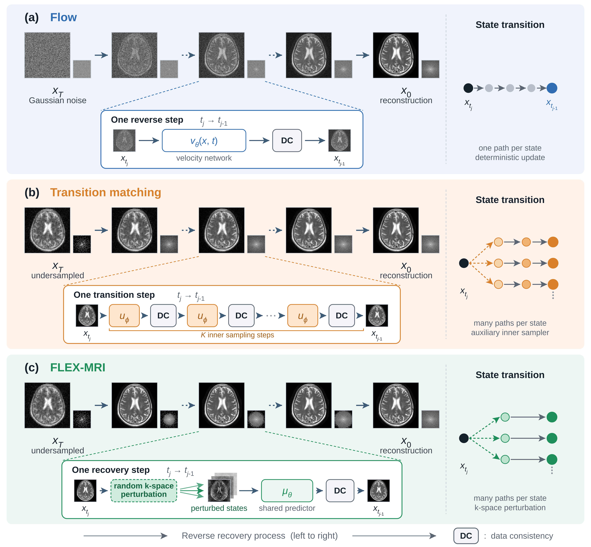

# FLEX-MRI

Official PyTorch implementation of FLEX-MRI as described in the
[paper](https://arxiv.org/abs/2610.13095).

Muhammad Usama Mirza, Esin Öztürk Işık, Tolga Çukur, "Stochastic Finite-Transition
Learning and Exploration for Accelerated MRI Reconstruction", arXiv 2026.



Generative MRI reconstruction maps an initial source distribution to the target
image distribution along a learned recovery trajectory. Common generative
methods, such as diffusion and flow, typically learn fine-grained local dynamics
whose integration defines this global mapping, hence requiring many network
evaluations at inference. Existing few-step sampling approaches can lower
computational burden by approximating large transformations from local dynamics,
albeit at the expense of reconstruction fidelity. FLEX-MRI instead partitions
recovery into a small number of finite intervals between retained states defined
by progressive changes in k-space support, and directly learns the
reconstruction change across each interval. Because such finite transitions can
admit multiple plausible outcomes, FLEX-MRI combines support-relaxed
finite-transition learning with stochastic exploration. During training,
randomized k-space sampling masks define finite-transition targets with varying
support, while the prediction loss remains unrestricted by each individual mask.
At inference, FLEX-MRI perturbs a random subset of currently estimated k-space
coefficients, allowing the learned predictor to stochastically explore
alternative transition paths. Each predicted state is then reconciled with the
acquired measurements through data consistency. We theoretically show that this
stochastic exploration induces nonzero transition-level variation through the
learned recovery map and data consistency without requiring an auxiliary
generative sampler. Experiments on multi-coil MRI datasets show that FLEX-MRI
outperforms competing methods while maintaining computational efficiency
comparable to few-step baselines.

## Where the method lives

`utils/finite_transition.py` holds the whole method as the `FlexMRI` class:

| paper | code |
|---|---|
| recovery trajectory | `FlexMRI.recovery_trajectory` (`reconstruct` runs it to the end) |
| task-aligned intermediate states | `FlexMRI.interpolate` |
| the source state (zero-filled reconstruction) | `FlexMRI.zero_filled` |
| the finite-transition predictor's objective | `FlexMRI.training_losses` |
| perturbing a random subset of estimated coefficients | `FlexMRI._stochastic_frequency_dropout` |
| reconciliation with the acquired measurements | `FlexMRI.data_consistency` |

The trajectory interpolates between the data-consistent zero-filled
reconstruction `x_zf` and the fully sampled image `x_0`, re-projecting onto the
measurements at every state:

```
alpha_t = (t + 1) / T
x_t     = DC( alpha_t * x_zf + (1 - alpha_t) * x_0 )
```

The predictor regresses the whole remaining jump `x_0 - x_t`; sampling walks
the same path with `x_0` replaced by its running estimate. Training and
sampling share one representation (complex SENSE images), one normalization
(99th percentile of the zero-filled magnitude, computed only from the
measurements) and one mask generator.

**`--transition_steps` must be the same at training and reconstruction.** It is
not a per-acceleration tuning parameter: `t` indexes a point on the trajectory
above and the time embedding is only ever trained at those values.

## Installation

Python 3.9 or newer, and a CUDA GPU for training.

```bash
pip install -r requirements.txt
```

## Data

FLEX-MRI is trained and evaluated on [M4Raw](https://github.com/mylyu/M4Raw),
a multi-contrast, multi-channel low-field (0.3 T) brain k-space dataset
(Lyu et al., *Scientific Data* 10, 2023,
[doi:10.1038/s41597-023-02181-4](https://doi.org/10.1038/s41597-023-02181-4);
CC-BY-4.0). Download `M4RawV1.5_multicoil_train.zip`, `M4RawV1.5_multicoil_val.zip`
and `M4Raw_multicoil_test.zip` from [Zenodo](https://doi.org/10.5281/zenodo.8056074)
and unzip them into one folder, `<data_dir>`:

```
<data_dir>/multicoil_train/*.h5
<data_dir>/multicoil_val/*.h5
<data_dir>/multicoil_test/*.h5
```

Each volume holds raw `kspace` and `reconstruction_rss`. Undersampling masks
are generated in `read_data.py` (Gaussian variable density with a fully
sampled center, exactly `H*W/R` samples). Coil sensitivities are estimated with
ESPIRiT and cached per volume under `$FLEX_MRI_COIL_MAP_CACHE`, or
`<data_dir>/coil_maps_cache` by default. Training skips volumes whose maps are
not cached, so build the cache first:

```bash
python precompute_coil_maps.py --data_path /path/to/M4Raw/ --phase train --workers 16
python precompute_coil_maps.py --data_path /path/to/M4Raw/ --phase test --workers 16
```

The job can be interrupted and resumed. `FLEX_MRI_ESPIRIT_DEVICE` selects the
ESPIRiT device (`auto`, `cpu`, `cuda:N`; GPU needs `cupy`).

## Training

```bash
bash train.sh /path/to/M4Raw/
```

Checkpoints are written to `exp/` every 25,000 iterations. The configuration:

| | |
|---|---|
| iterations | 125,000 |
| batch size | 2, with 8 iterations per optimizer step |
| learning rate | 1e-4, 5k-iteration warmup, cosine decay to 1e-6 |
| dropout / EMA | 0.3 / 0.9999 |
| transitions | 10 |
| training masks | a fresh mask per sample, at a random acceleration in `[2, 8]` |

Every setting can be overridden from the environment (`GPU`, `PYTHON`,
`SAVE_DIR`, `CONTRAST`, `NUM_WORKERS`, `BATCH_SIZE`, `STEPS`, `LR`,
`TRANSITION_STEPS`, `R_MIN`, `R_MAX`, ...), and extra arguments go to
`train.py`, e.g. `--max_volumes 4 --slices_per_volume 2` for a quick smoke run.

To continue an interrupted run (weights, EMA, optimizer state and step count),
pass the last checkpoint through `train.sh`:

```bash
bash train.sh /path/to/M4Raw/ --resume_checkpoint exp/model025000.pt
```

## Reconstruction

```bash
bash test.sh /path/to/M4Raw/ exp/model125000.pt
```

`test.sh` sweeps `R_VALUES` (default `2 4 6 8`) x `CONTRASTS` (default
`T1 T2 FLAIR`) and writes `rss<i>.npy`, `sense<i>.npy` and a PNG per slice to
`SAVE_ROOT/<R>x_<contrast>` (default `results/<checkpoint dir name>`). RSS
matches the `reconstruction_rss` ground truth; the complex SENSE image keeps
phase (`--save_sense False` skips it, about 15 GB per full sweep). Use the raw
weights (`model<step>.pt`): at `ema_rate` 0.9999 the EMA lags about 7k
iterations behind.

## Evaluation

```bash
python evaluate.py --data_path /path/to/M4Raw/ --results results/exp
```

PSNR and SSIM against `reconstruction_rss` for every acceleration and
contrast, with zero-filling as the baseline. Masks are regenerated with the
seeds `sample.py` used.

## Files

```
read_data.py             M4Raw volumes, training slices, test data, masks
espirit.py               sigpy ESPIRiT coil sensitivity estimation
coil_map_cache.py        per-volume disk cache for the ESPIRiT maps
precompute_coil_maps.py  fill that cache for a split
train.py  sample.py      training / reconstruction entry points
evaluate.py              PSNR / SSIM against reconstruction_rss
train.sh  test.sh        the training recipe / the test sweep
figures/                 the overview figure above
utils/
  finite_transition.py   FLEX-MRI: the finite-transition process
  unet.py                the finite-transition predictor
  train_util.py          training loop
  resample.py            transition sampling schedule
  script_util.py         model / transition construction from arguments
  kspace_dataset.py      training slices -> batches
  logger.py, nn.py, fp16_util.py, dist_util.py
```

## Citation

You are encouraged to modify/distribute this code. However, please acknowledge
this code and cite the paper appropriately.

```bibtex
@misc{mirza2026stochastic,
      title={Stochastic Finite-Transition Learning and Exploration for Accelerated MRI Reconstruction},
      author={Muhammad Usama Mirza and Esin Öztürk Işık and Tolga Çukur},
      year={2026},
      eprint={2610.13095},
      archivePrefix={arXiv},
      primaryClass={eess.IV}
}
```

## Acknowledgements

This code uses libraries from the
[Improved DDPM](https://github.com/openai/improved-diffusion) repository. Coil
maps are estimated with [SigPy](https://github.com/mikgroup/sigpy). Data:
[M4Raw](https://github.com/mylyu/M4Raw).

## License

Released under the [MIT License](LICENSE).

(c) ICON Lab 2026
