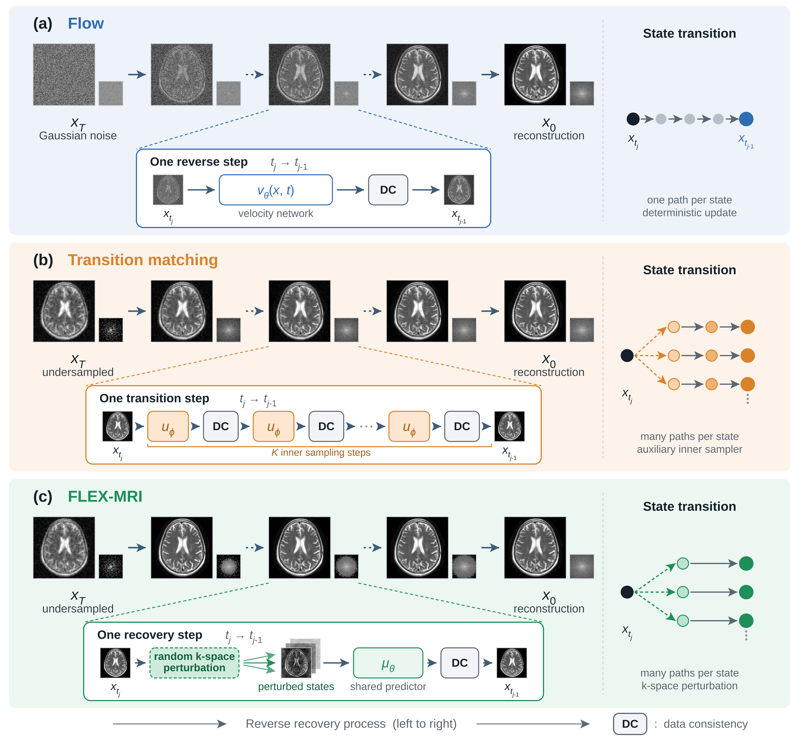

# FLEX-MRI

Official PyTorch implementation of FLEX-MRI as described in the
[paper](https://arxiv.org/abs/2610.13095).

Muhammad Usama Mirza, Esin Öztürk Işık, Tolga Çukur, "Stochastic Finite-Transition
Learning and Exploration for Accelerated MRI Reconstruction", arXiv 2026.



Generative MRI reconstruction maps an initial source distribution to the target
image distribution along a learned recovery trajectory. Common generative
methods, such as diffusion and flow, typically learn fine-grained local dynamics
whose integration defines this global mapping, hence requiring many network
evaluations at inference. Existing few-step sampling approaches can lower
computational burden by approximating large transformations from local dynamics,
albeit at the expense of reconstruction fidelity. FLEX-MRI instead partitions
recovery into a small number of finite intervals between retained states defined
by progressive changes in k-space support, and directly learns the
reconstruction change across each interval. Because such finite transitions can
admit multiple plausible outcomes, FLEX-MRI combines support-relaxed
finite-transition learning with stochastic exploration. During training,
randomized k-space sampling masks define finite-transition targets with varying
support, while the prediction loss remains unrestricted by each individual mask.
At inference, FLEX-MRI perturbs a random subset of currently estimated k-space
coefficients, allowing the learned predictor to stochastically explore
alternative transition paths. Each predicted state is then reconciled with the
acquired measurements through data consistency. We theoretically show that this
stochastic exploration induces nonzero transition-level variation through the
learned recovery map and data consistency without requiring an auxiliary
generative sampler. Experiments on multi-coil MRI datasets show that FLEX-MRI
outperforms competing methods while maintaining computational efficiency
comparable to few-step baselines.

## Where the method lives

`utils/finite_transition.py` holds the whole method as the `FlexMRI` class:

| paper | code |
|---|---|
| retained states from progressive changes in k-space support | `FlexMRI.state_masks` |
| support-relaxed finite-transition objective | `FlexMRI.training_losses` |
| stochastic k-space perturbation `P_gamma` | `FlexMRI.perturb` |
| data-consistency projection | `FlexMRI.data_consistency` |
| few-step recovery (Algorithm 1) | `FlexMRI.recovery_steps` (`reconstruct` runs it to the end) |
| the endpoint state at inference (zero-filled reconstruction) | `FlexMRI.zero_filled` |

**Retained states.** `Omega` is the support of the undersampled endpoint
`x_J` (a variable-density mask at R = 6). Each coefficient outside `Omega` gets
a priority `rho_i ~ U(0, 1)`, and state `t` keeps it while `rho_i >= t / J`:

```
m_t = Omega + { i not in Omega : rho_i >= t / J }
x_t = F^-1[ m_t * F(x_0) ]
```

`x_0` is fully sampled, `x_J` is the endpoint, and the masks are nested. The
states are binary changes in k-space support; nothing is interpolated.

**Training.** Transition `j` goes from `x_j` to `x_{j-1}`. Its target is the
individual finite increment `x_{j-1} - x_j = F^-1[ eta_j * F(x_0) ]`, with
`eta_j = m_{j-1} - m_j`, and the predictor `mu_theta(x_j, j-1)` is trained with
the support-relaxed L1 loss `10 * || mu_theta(x_j, j-1) - (x_{j-1} - x_j) ||_1`
(mean absolute error): the transition mask defines the target but is not
applied to the error. The
transition masks are redrawn for every sample, and the training inputs are the
unperturbed states.

**Recovery.** Starting from the zero-filled endpoint, each of the `J = 10`
transitions perturbs the current estimate by dropping every k-space
coefficient independently with probability `gamma_j`, adds the predicted
transition, and re-imposes the acquired coefficients (hard data consistency):

```
gamma_j = gamma * rho_hat * (j-1) / J
x~      = F^-1[ z * F(x_j) ],   z[i] ~ Bernoulli(1 - gamma_j)
x_{j-1} = DC( x~ + mu_theta(x~, j-1) )
```

`rho_hat` is the unacquired fraction of k-space and `gamma = 0.1` is the base
rate, so the perturbation is largest at the first transition and decays
linearly to zero at the last.

**Multi-coil data.** Images are SENSE coil-combined complex images (ESPIRiT
maps), carried as two real channels, and data consistency uses the coil maps.
Every slice is divided by the 99th percentile of its zero-filled magnitude,
which needs only the undersampled data, so training and reconstruction share
it.

**Ablations.** `--objective restricted` evaluates the loss only on the
coefficients in `eta_j`, `--train_perturbation <rate>` perturbs the training
inputs on the same schedule, and `--gamma 0` makes recovery deterministic.

**`--transition_steps` must be the same at training and reconstruction.** It
is `J`; the states each `t` was trained on depend on it.

## Installation

Python 3.9 or newer, and a CUDA GPU for training.

```bash
pip install -r requirements.txt
```

## Data

FLEX-MRI is trained and evaluated on [M4Raw](https://github.com/mylyu/M4Raw),
a multi-contrast, multi-channel low-field (0.3 T) brain k-space dataset
(Lyu et al., *Scientific Data* 10, 2023,
[doi:10.1038/s41597-023-02181-4](https://doi.org/10.1038/s41597-023-02181-4);
CC-BY-4.0). Download `M4RawV1.5_multicoil_train.zip`, `M4RawV1.5_multicoil_val.zip`
and `M4Raw_multicoil_test.zip` from [Zenodo](https://doi.org/10.5281/zenodo.8056074)
and unzip them into one folder, `<data_dir>`:

```
<data_dir>/multicoil_train/*.h5
<data_dir>/multicoil_val/*.h5
<data_dir>/multicoil_test/*.h5
```

Each volume holds raw `kspace` and `reconstruction_rss`. Undersampling masks
are generated in `read_data.py` (Gaussian variable density with a fully
sampled center, exactly `H*W/R` samples). Coil sensitivities are estimated with
ESPIRiT and cached per volume under `$FLEX_MRI_COIL_MAP_CACHE`, or
`<data_dir>/coil_maps_cache` by default. Training skips volumes whose maps are
not cached, so build the cache first:

```bash
python precompute_coil_maps.py --data_path /path/to/M4Raw/ --phase train --workers 16
python precompute_coil_maps.py --data_path /path/to/M4Raw/ --phase test --workers 16
```

The job can be interrupted and resumed. `FLEX_MRI_ESPIRIT_DEVICE` selects the
ESPIRiT device (`auto`, `cpu`, `cuda:N`; GPU needs `cupy`).

## Training

```bash
bash train.sh /path/to/M4Raw/
```

Checkpoints are written to `exp/` every 25,000 iterations. The configuration:

| | |
|---|---|
| iterations | 125,000 |
| batch size | 1, with 8 iterations per optimizer step |
| learning rate | 1e-4, 5k-iteration warmup, cosine decay to 1e-6 |
| dropout / EMA | 0.3 / 0.9999 |
| transitions `J` | 10 |
| endpoint state | variable-density mask at R = 6, redrawn per sample |
| objective | support-relaxed L1 (x10) on the finite increment, unperturbed inputs |

Every setting can be overridden from the environment (`GPU`, `PYTHON`,
`SAVE_DIR`, `CONTRAST`, `NUM_WORKERS`, `BATCH_SIZE`, `STEPS`, `LR`,
`TRANSITION_STEPS`, `ENDPOINT_R`, `OBJECTIVE`, `TRAIN_PERTURBATION`, ...), and extra arguments go to
`train.py`, e.g. `--max_volumes 4 --slices_per_volume 2` for a quick smoke run.

To continue an interrupted run (weights, EMA, optimizer state and step count),
pass the last checkpoint through `train.sh`:

```bash
bash train.sh /path/to/M4Raw/ --resume_checkpoint exp/model025000.pt
```

## Reconstruction

```bash
bash test.sh /path/to/M4Raw/ exp/ema_0.9999_125000.pt
```

`test.sh` runs `J = 10` transitions with base perturbation rate `GAMMA`
(default 0.1; `SEED` fixes the perturbations), sweeping `R_VALUES`
(default `2 4 6 8`) x `CONTRASTS` (default `T1 T2 FLAIR`), and writes `rss<i>.npy`, `sense<i>.npy` and a PNG per slice to
`SAVE_ROOT/<R>x_<contrast>` (default `results/<checkpoint dir name>`). The
complex SENSE image (`sense<i>.npy`) is what `evaluate.py` scores; the RSS
image follows the convention of M4Raw's `reconstruction_rss`. A full sweep
takes about 40 GB. Reconstruct with the EMA weights (`ema_0.9999_<step>.pt`);
the raw weights (`model<step>.pt`) are saved for resuming training.

## Evaluation

```bash
python evaluate.py --data_path /path/to/M4Raw/ --results results/exp
```

PSNR and SSIM for every acceleration and contrast, with zero-filling as the
baseline, using the evaluation protocol of the paper's fastMRI experiments: the
magnitude of the reconstructed SENSE image is compared with the magnitude of
the coil-combined fully sampled image (same ESPIRiT maps), both divided by
their mean, with the background (outside the coil-map support) set to zero.
Masks are regenerated with the seeds `sample.py` used.

## Files

```
read_data.py             M4Raw volumes, training slices, test data, masks
espirit.py               sigpy ESPIRiT coil sensitivity estimation
coil_map_cache.py        per-volume disk cache for the ESPIRiT maps
precompute_coil_maps.py  fill that cache for a split
train.py  sample.py      training / reconstruction entry points
evaluate.py              PSNR / SSIM (fastMRI evaluation protocol)
train.sh  test.sh        the training recipe / the test sweep
figures/                 the overview figure above
utils/
  finite_transition.py   FLEX-MRI: the finite-transition process
  unet.py                the finite-transition predictor
  train_util.py          training loop
  resample.py            transition sampling schedule
  script_util.py         model / transition construction from arguments
  kspace_dataset.py      training slices -> batches
  logger.py, nn.py, fp16_util.py, dist_util.py
```

## Citation

You are encouraged to modify/distribute this code. However, please acknowledge
this code and cite the paper appropriately.

```bibtex
@misc{mirza2026stochastic,
      title={Stochastic Finite-Transition Learning and Exploration for Accelerated MRI Reconstruction},
      author={Muhammad Usama Mirza and Esin Öztürk Işık and Tolga Çukur},
      year={2026},
      eprint={2610.13095},
      archivePrefix={arXiv},
      primaryClass={eess.IV}
}
```

## Acknowledgements

This code uses libraries from the
[Improved DDPM](https://github.com/openai/improved-diffusion) repository. Coil
maps are estimated with [SigPy](https://github.com/mikgroup/sigpy). Data:
[M4Raw](https://github.com/mylyu/M4Raw).

## License

Released under the [MIT License](LICENSE).

(c) ICON Lab 2026
